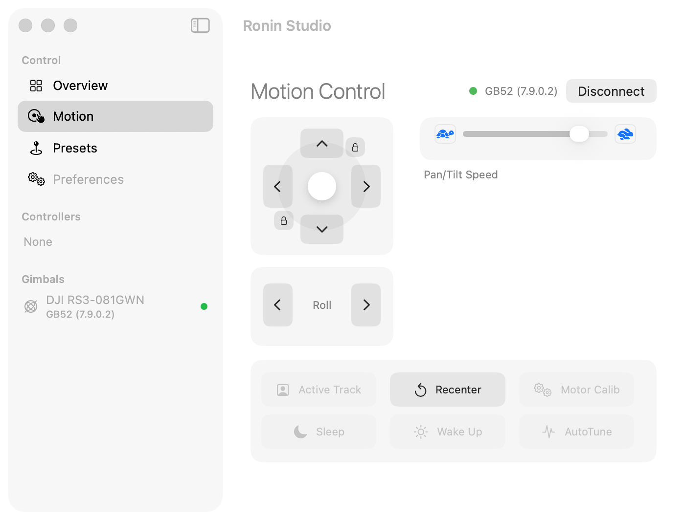
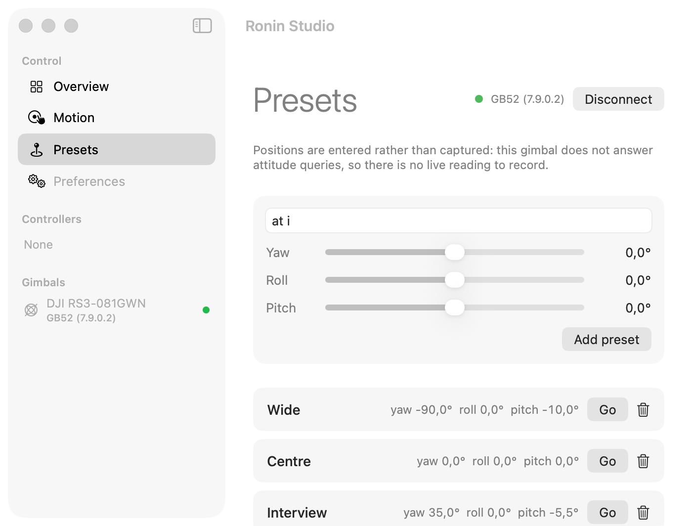
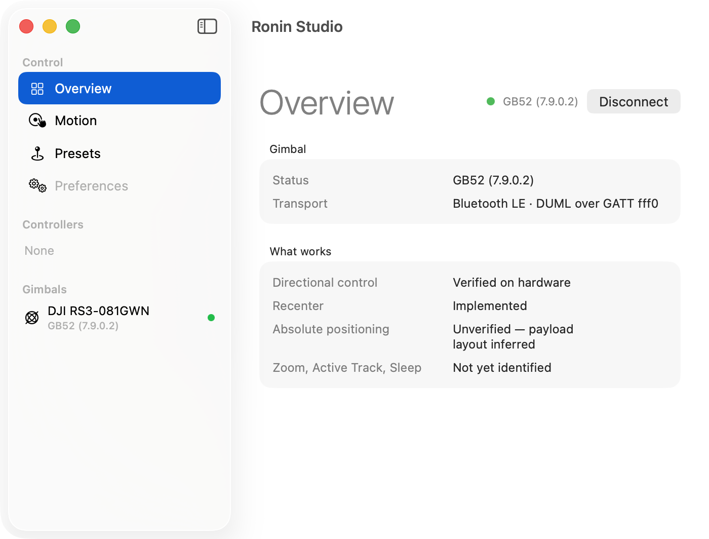

# DJI Ronin Bluetooth Connector

Control a **DJI RS-series gimbal** over Bluetooth LE from Rust, with a small
macOS app on top. No vendor app, no APC-R controller, no CAN adapter — just the
Bluetooth radio your Mac already has.

Developed and verified against a physical **DJI RS3** (hardware id `GB52`,
firmware 7.9.0.2). Motion is confirmed working.



## How it connects

The gimbal exposes a single GATT service, `fff0`, with two characteristics that
matter:

| | |
|---|---|
| `fff5` | commands out (write without response) |
| `fff4` | notifications in |

(`fff3` advertises notify but carries no CCCD, so it cannot be subscribed to.)

Across those characteristics it speaks **DUML**, DJI's framing. Every frame is:

```text
[0]     SOF 0x55
[1..3]  u16 LE: length in bits 0..9, version in bits 10..15   (version is 1)
[3]     CRC8  over bytes [0..3]        seed 0x77
[4]     source   0x02 = us
[5]     target   0x04 = gimbal
[6..8]  u16 LE sequence number
[8]     cmd_type  low nibble 3 = reply required; bit 7 set on replies
[9]     CmdSet    0x04 = gimbal, 0x00 = common
[10]    CmdID     0x0c = ControlGimbalSpeed
[11..]  payload
[..]    CRC16 over everything preceding  seed 0x3692
```

Both checksums are reflected and table-driven, and both use a non-standard
seed. Get a seed wrong and the gimbal drops the frame in silence — no error, no
reply, just nothing, which is easy to mistake for a dead link.

Motion is `ControlGimbalSpeed`: a 7-byte body of three little-endian `i16`
axes plus a control byte. It expresses a **rate, not a destination**, and it
lapses, so sustained movement means resending it at roughly 10 Hz; stop talking
and the gimbal coasts to a halt.

### Two things worth knowing before you debug anything

- **The gimbal is push-oriented, not request/response.** It answers exactly one
  query — `CommonGetVersion` — and ignores the rest, while streaming model
  type, lock status, battery and camera state unprompted.
- **Control commands are fire-and-forget.** They are acted on and send no
  reply. A silent command is a *normal* command, so "did we get a response" is
  the wrong test and makes a working link look broken.

## Architecture

```
crates/rs3        the library — framing, checksums, BLE transport, presets
crates/rs3-ffi    a C ABI over it, so Swift never deals with async
app/              the macOS app (SwiftUI)
```

`crates/rs3` is async (tokio + btleplug) and is the whole protocol. `rs3-ffi`
wraps it in blocking `extern "C"` calls owning their own runtime, and the app
drives those from one serial queue, publishing back on the main actor. Nothing
in the UI knows what a frame looks like.

## The macOS app

```bash
cd app && ./bundle.sh && open "Ronin Studio.app"
```

Press and hold an arrow to move, or drag the stick — distance from the centre
sets the rate. Release to stop. Controls that need a gimbal dim when there
isn't one, and buttons whose command has not been identified are dimmed too,
rather than looking live and doing nothing.

| Presets | Overview |
|---|---|
|  |  |

Positions are entered rather than captured: the gimbal does not answer attitude
queries, so there is no live reading to record. Presets are a CSV the library
and the app both read, so the CLI and the UI agree.

`--demo [pane]` brings the window up with a stand-in gimbal and no Bluetooth,
which is how the screenshots above were taken.

**Why the app is bundled by hand.** It is a SwiftPM executable wrapped in a
`.app` so that its `Info.plist` can carry `NSBluetoothAlwaysUsageDescription` —
macOS kills *any* process that touches CoreBluetooth without it. The CLI has to
be run from a terminal you launched yourself; the app just asks properly.

A session log lands at `~/Library/Logs/RoninStudio.log`.

## Using the library

```rust
use rs3::{Direction, Gimbal, Position, Preset, PresetStore};
use std::time::Duration;

let gimbal = Gimbal::connect_first().await?;
println!("{}", gimbal.version().await?);       // GB52 (7.9.0.2, ...)

gimbal.nudge(Direction::Left, 400, Duration::from_secs(1)).await?;
gimbal.nudge(Direction::Up, 250, Duration::from_millis(500)).await?;
gimbal.stop().await?;

let mut presets = PresetStore::load(PresetStore::default_path())?;
presets.add(Preset::new("wide", Position::from_degrees(-90.0, 0.0, -10.0)));
presets.save(PresetStore::default_path())?;
gimbal.goto(presets.get("wide").unwrap().position).await?;
```

## Command line

```bash
cargo run --example cli -- scan
cargo run --example cli -- version
cargo run --example cli -- move left 400 1.0
cargo run --example cli -- live
cargo run --example cli -- preset save wide -90 0 -10
cargo run --example cli -- raw 0x04 0x0c c80000000000 80
```

## What is verified, and what is not

| | |
|---|---|
| Framing, checksums, addressing | Verified against hardware |
| Multi-frame notification reassembly | Verified |
| `CommonGetVersion` | Verified — returns `GB52` |
| `ControlGimbalSpeed` | **Verified — moves the gimbal** |
| `ResetAndSetMode` (recentre) | Implemented, body `FE 01` |
| Axis mapping (yaw/roll/pitch order) | **Assumed** — fields not pinned to physical axes |
| Units | **Assumed** — the sibling CAN protocol uses 0.1 deg/s |
| `ControlGimbalAngle` (`goto`) | **Unverified** — layout inferred |

`cargo test` exercises the protocol against frames captured from real hardware;
none of it needs a gimbal present.

## Licence

MIT.
